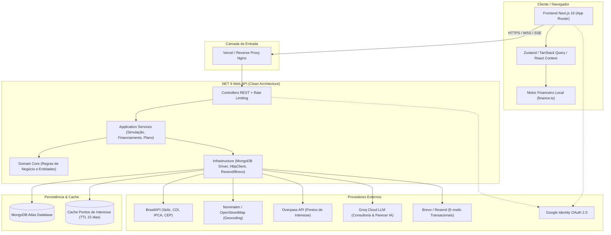
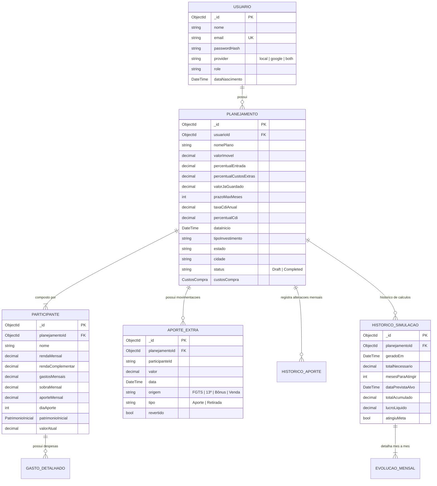

# 🏡 Documentação Técnica do Sistema Imov.Plan

> **Versão do Documento:** 1.0  
> **Status do Sistema:** Produção / Ativo  
> **Tecnologias Centrais:** .NET 9 (C#), Next.js 16 (React 19), Tailwind CSS v4, MongoDB  

---

## 📑 Sumário

1. [Visão Geral e Propósito](#1-visão-geral-e-propósito)
2. [Arquitetura Geral da Solução](#2-arquitetura-geral-da-solução)
3. [Modelagem de Dados (MongoDB)](#3-modelagem-de-dados-mongodb)
4. [Backend (.NET 9 — Clean Architecture)](#4-backend-net-9--clean-architecture)
5. [Frontend (Next.js 16 + React 19)](#5-frontend-nextjs-16--react-19)
6. [Motor de Cálculos e Regras Financeiras](#6-motor-de-cálculos-e-regras-financeiras)
7. [Recursos Inteligentes (IA e Geolocalização)](#7-recursos-inteligentes-ia-e-geolocalização)
8. [Referência da API REST](#8-referência-da-api-rest)
9. [Guia de Execução e Desenvolvimento](#9-guia-de-execução-e-desenvolvimento)
10. [Segurança e Resiliência](#10-segurança-e-resiliência)

---

## 1. Visão Geral e Propósito

### 1.1 O Problema
A aquisição de um imóvel no Brasil envolve uma das maiores tomadas de decisão financeira de uma família. Entretanto, simuladores bancários tradicionais apresentam deficiências estruturais:
- Analisam apenas a fase de financiamento isolada, desconsiderando a preparação prévia (acumulação de capital).
- Ignoram custos documentais e cartorários fundamentais (ITBI, escritura, emolumentos de registro), que variam entre 3% e 6% do valor do imóvel.
- Não incorporam rendimentos reais sobre os aportes mensais considerando o CDI líquido com alíquota regressiva de Imposto de Renda.
- Não suportam de forma dinâmica a composição familiar de múltiplos participantes e suas rendas/despesas individualizadas.

### 1.2 A Solução: Imov.Plan
O **Imov.Plan** é uma plataforma que cobre todo o ciclo de compra imobiliária:
1. **Planejamento Pré-Compra**: Definição da meta de entrada somada aos custos documentais, mapeamento de reservas existentes e simulação de rentabilidade em renda fixa.
2. **Dinâmica Familiar**: Gestão de múltiplos participantes (cônjuges, familiares, investidores), receitas líquidas, benefícios e despesas para apurar a capacidade real de poupança conjunta.
3. **Imóvel Pronto vs. Na Planta**: Suporte aos dois perfis de compra, incluindo parcelas durante obra, balões intermediários e correção monetária.
4. **Linha do Tempo e Aportes Extraordinários**: Evolução patrimonial mês a mês e dia a dia, com injeções programadas de FGTS, 13º salário, bonificações e restituição do IR.
5. **Simulador de Financiamento Bancário**: Comparação dos sistemas SAC e PRICE, cálculo de Custo Efetivo Total (CET com seguros MIP e DFI) e validação da margem prudencial de comprometimento de renda (30%).
6. **Análise de Localização e Arredores**: Mapeamento de comodidades no entorno (escolas, supermercados, hospitais, parques) com parecer automatizado via Inteligência Artificial.

---

## 2. Arquitetura Geral da Solução

O ecossistema é desacoplado em frontend e backend, operando sob o seguinte diagrama de alto nível:



### 2.1 Principais Características da Arquitetura
- **Clean Architecture no Backend**: Separação rigorosa entre regras puras de domínio (`Domain`), orquestração de casos de uso (`Application`), integrações e persistência (`Infrastructure`), e endpoints HTTP (`Presentation.API`).
- **Paridade Estrita entre Frontend e Backend**: A simulação financeira executa de forma reativa no frontend (`finance.ts`) para respostas instantâneas na interface e possui implementação idêntica no backend (`SimulacaoService.cs`), validada continuamente por suíte de testes de paridade com fixtures JSON compartilhadas.
- **Autosave e Draft Contínuo**: As alterações feitas pelo usuário na interface sincronizam automaticamente com a API sem bloqueios, mantendo o estado de rascunho persistido no banco de dados.

---

## 3. Modelagem de Dados (MongoDB)

A aplicação utiliza o MongoDB através do driver oficial em C# com a convenção global `IgnoreExtraElements` ativada, garantindo compatibilidade reversa entre versões do schema.

### 3.1 Diagrama Entidade-Relacionamento Conceitual



### 3.2 Descrição das Coleções

| Coleção | Descrição | Índices Chave |
| :--- | :--- | :--- |
| `usuarios` | Contas de usuários, credenciais bcrypt e logins sociais. | `email` (Unique), `resetPasswordToken` |
| `planejamentos` | Planos de aquisição imobiliária, metas, custos e metadados. | `usuarioId`, `status`, `createdAt` |
| `participantes` | Pessoas que compõem a renda e aportes de um plano. | `planejamentoId` |
| `aportesExtras` | Injeções e retiradas pontuais de capital (FGTS, 13º, bônus). | `planejamentoId`, `data` |
| `historicosAportes` | Registros de customização manual de aportes por mês. | `planejamentoId`, `mes` |
| `gastosDetalhados` | Despesas categorizadas por participante. | `planejamentoId`, `participanteId` |
| `historicoSimulacoes` | Snapshots imutáveis de simulações executadas. | `planejamentoId`, `geradoEm` |
| `evolucoesMensais` | Linhas detalhadas mês a mês de uma simulação persistida. | `simulacaoId`, `mes` |
| `parametrosFinanceiros` | Taxas do mercado, alíquotas de IR, bancos e faixas de cartório. | `codigo`, `ativo` |
| `pontosInteresseCache` | Cache de consultas espaciais de arredores (OSM/Overpass). | `createdAt` (Índice TTL: 15 dias) |

---

## 4. Backend (.NET 9 — Clean Architecture)

O backend é construído em **ASP.NET Core Web API** com **.NET 9**, organizado em projetos estruturados por responsabilidade.

### 4.1 Estrutura de Projetos
```
backend/
├── Core/
│   ├── ImovPlan.Domain/           # Entidades puras, Enums e Interfaces de Repositórios
│   └── ImovPlan.Application/      # Casos de uso, DTOs, Serviços de Domínio e Validadores
├── Infrastructure/
│   └── ImovPlan.Infrastructure/   # Repositórios MongoDB, Provedores HTTP e E-mail
├── Presentation/
│   └── ImovPlan.API/              # Controllers REST, Middlewares, Auth e Program.cs
└── Tests/
    └── ImovPlan.Application.Tests/# Testes Unitários e Testes de Paridade com Frontend
```

### 4.2 Serviços de Aplicação (`Application/Services`)
1. **`PlanejamentoService`**: Gerencia o ciclo de vida dos planos imobiliários, criação de drafts para usuários autenticados, resolução de concorrência com travas na memória (`SemaphoreSlim`), vinculação de planos e atualização reativa de custos.
2. **`SimulacaoService`**: Executa a simulação financeira mês a mês, projetando a evolução patrimonial individual e conjunta, cálculo de juros compostos, pro-rata diário de aportes, incidência de IR regressivo e verificação da meta.
3. **`FinanciamentoService`**:
   - `SimularSAC`: Amortização constante com parcelas decrescentes.
   - `SimularPrice`: Parcelas fixas com amortização crescente.
   - `CalcularCET`: Custo Efetivo Total anualizado, ponderando taxa de juros, taxa administrativa, seguro MIP (Morte e Invalidez Permanente) e seguro DFI (Danos Físicos ao Imóvel).
   - `SimularFGTS`: Uso de saldo FGTS para amortização de prazo ou redução de parcela.
   - `VerificarComprometimentoRenda`: Checagem da regra dos 30% da renda bruta familiar.
4. **`CalculoFinanceiroService`**: Métodos auxiliares para cálculo de entrada percentual, taxas acessórias e saldo líquido familiar.

### 4.3 Serviços de Infraestrutura (`Infrastructure/Services`)
- **`BrasilApiFinancialProvider`**: Obtém taxas vigentes de Selic, CDI e IPCA através da BrasilAPI.
- **`BrasilApiLocationProvider`**: Resolução de CEP e endereços oficiais.
- **`OverpassPontoInteresseService`**: Realiza consultas espaciais à API Overpass (OpenStreetMap) buscando amenidades no raio de 2 km a 5 km.
- **`GroqAiService`**: Comunicação com a API Groq Cloud (modelos LLaMA 3 / Mixtral) para geração de consultoria financeira e parecer da região com suporte a **Server-Sent Events (SSE)** em tempo real.
- **`BrevoEmailService` / `ResendEmailService`**: Envio de templates de e-mail para confirmação de conta e recuperação de senha.

### 4.4 Configuração de Segurança e Middlewares (`Program.cs`)
- **Autenticação Dupla**: Suporte a autenticação via Header `Authorization: Bearer <token>` ou via Cookie `HttpOnly` com nome `token`, garantindo proteção robusta contra ataques XSS no navegador.
- **Rate Limiting Nativo**:
  - `auth`: 10 requisições por minuto por IP.
  - `ia`: Rate limit para chamadas aos endpoints de Inteligência Artificial.
  - `geocode`: 1 requisição por segundo para conformidade com a política de uso do Nominatim/OSM.
- **Security Headers**: Inclusão automática de `X-Content-Type-Options: nosniff`, `X-Frame-Options: DENY`, `Referrer-Policy: strict-origin-when-cross-origin` e `Strict-Transport-Security` (HSTS).
- **Background Hosted Services**:
  - `MongoDbIndexInitializer`: Inicializa índices e regras de TTL na inicialização do servidor.
  - `LembretePlanejamentoService`: Tarefa recorrente em segundo plano para monitoramento de rotinas do sistema.

---

## 5. Frontend (Next.js 16 + React 19)

O frontend foi desenvolvido utilizando a arquitetura do **App Router** do Next.js 16, integrado com **React 19** e **Tailwind CSS v4**.

### 5.1 Estrutura de Diretórios
```
frontend/src/
├── app/                           # Rotas da aplicação (App Router)
│   ├── (public)/                  # Landing Page e Páginas Institucionais
│   ├── auth/                      # Login, Registro, Recuperação de Senha
│   └── app/                       # Aplicação Protegida
│       ├── onboarding/            # Assistente inicial de configuração
│       ├── imovel/                # Configuração do imóvel alvo
│       ├── pessoas/               # Composição de participantes, rendas e despesas
│       ├── planejamento/          # Visão central da linha do tempo e aportes
│       ├── resultado/             # Gráficos, métricas e viabilidade
│       ├── financiamento/         # Comparativo SAC vs PRICE e simulação bancária
│       ├── planos/                # Meus Planos (gestão de múltiplos cenários)
│       └── perfil/                # Preferências e configurações da conta
├── components/                    # Componentes modulares
│   ├── AppShell.tsx               # Layout mestre com navegação e status
│   ├── PessoaCard.tsx             # Card de gestão financeira do participante
│   ├── TabelaMesAMes.tsx          # Tabela virtualizada de alta performance
│   └── TabelaMesAMes/             # Subcomponentes (Modal Diário, Edição de Aportes)
├── context/                       # AuthContext e PlanContext
├── hooks/                         # Custom Hooks para queries e mutações
├── lib/
│   ├── api.ts                     # Instância configurada do Axios com interceptors
│   ├── finance.ts                 # Motor financeiro puro em TypeScript
│   └── seo.ts                     # Utilitários de metadados e tags canônicas
└── store/
    └── usePlanStore.ts            # Gerenciamento de estado global com Zustand
```

### 5.2 Gerenciamento de Estado
- **`usePlanStore` (Zustand)**: Mantém o estado reativo da simulação ativa (valores de entrada, participantes, aportes extras, prazo e taxas), acionando o recalculo do motor financeiro a cada mutação.
- **`AuthContext`**: Gerencia o ciclo de vida do usuário autenticado, validação de token, estado de carregamento e integração com o login do Google.
- **`TanStack React Query v5`**: Orquestra caching, revalidação e mutações com a API REST, assegurando sincronização contínua do draft.

### 5.3 A Tabela Mês a Mês (`TabelaMesAMes.tsx`)
A tabela de cronograma financeiro é o componente central da experiência do usuário:
- **Virtualização de Linhas (`react-virtuoso`)**: Renderiza com fluidez cronogramas extensos (até 600 meses) sem degradação de performance na DOM.
- **Edição Inline de Aportes**: Permite que o usuário clique em qualquer mês futuro e ajuste o valor aportado individualmente ou em conjunto.
- **Detalhamento Diário (`DetalheMesDiarioModal.tsx`)**: Modal que expõe o rendimento composto dia útil a dia útil daquele mês, considerando a data exata de cada aporte e retiradas.
- **Gestão de Aportes Extras e Retiradas**: Inclusão de bônus, 13º, retiradas de emergência e FGTS com impacto direto no recalculo do prazo.

---

## 6. Motor de Cálculos e Regras Financeiras

O núcleo de inteligência financeira do sistema foi modelado em conformidade com as práticas do Sistema Financeiro Nacional (SFN) e a legislação tributária brasileira.

### 6.1 Meta de Aquisição e Custos Acessórios
$$\text{Meta Total} = \text{Valor da Entrada} + \text{Custos Documentais}$$

$$\text{Valor da Entrada} = \text{Valor do Imóvel} \times \left(\frac{\% \text{ Entrada}}{100}\right)$$

$$\text{Custos Documentais} = \text{ITBI} + \text{Escritura Pública} + \text{Registro de Imóveis}$$

- **ITBI (Imposto de Transmissão de Bens Imóveis)**: Alíquota padrão de 2% a 3% conforme o município.
- **Regras Específicas do Estado de São Paulo**:
  - Isenção de ITBI para imóveis enquadrados em programas habitacionais até o limite legal (ex: R$ 335.000,00).
  - Alíquotas reduzidas no Sistema Financeiro de Habitação (SFH) até o teto de R$ 1.500.000,00.
- **Emolumentos de Cartório**: Faixas progressivas com percentual regressivo conforme o valor do imóvel (1,5% a 0,9%).

### 6.2 Rentabilidade da Reserva e Tabela Regressiva de IR
A taxa anual efetiva é calculada com base no percentual contratado do CDI:
$$i_{\text{anual}} = \left(\frac{\text{CDI}}{100}\right) \times \left(\frac{\% \text{ CDI}}{100}\right)$$

A conversão para a taxa mensal equivalente segue a convenção de juros compostos:
$$i_{\text{mensal}} = (1 + i_{\text{anual}})^{\frac{1}{12}} - 1$$

E a taxa diária para apuração nos dias úteis (convenção de 252 dias úteis por ano):
$$i_{\text{diária}} = (1 + i_{\text{anual}})^{\frac{1}{252}} - 1$$

#### Alíquotas Regressivas de Imposto de Renda (Renda Fixa / CDB):
$$\text{Imposto} = \text{Rendimento Bruto} \times \text{Alíquota}$$

| Prazo Decorrido | Dias Corridos | Alíquota de IR |
| :--- | :--- | :--- |
| Até 6 meses | Até 180 dias | **22,5%** |
| De 6 meses a 1 ano | De 181 a 360 dias | **20,0%** |
| De 1 a 2 anos | De 361 a 720 dias | **17,5%** |
| Acima de 2 anos | Acima de 720 dias | **15,0%** |

> *Nota: Investimentos classificados como LCI (Letra de Crédito Imobiliário) ou LCA possuem alíquota zero de Imposto de Renda.*

### 6.3 Regra Pro-Rata Mensal de Rendimentos
Para espelhar a realidade dos aportes ao longo do mês:
1. O saldo de abertura do mês rende durante os **30 dias completos**.
2. O aporte regular mensal (programado para o dia 5 padrão) rende na proporção:
   $$\text{Fator} = \frac{30 - 5}{30} = \frac{25}{30}$$
3. Aportes extras rendem de acordo com o dia de crédito informado:
   $$\text{Fator}_{\text{extra}} = \frac{30 - \text{Dia do Mês}}{30}$$
4. Retiradas efetuadas abatem da base de cálculo de rendimento daquele mês.

### 6.4 Sistemas de Financiamento: SAC vs. PRICE
Dado o principal financiado $PV$, a taxa mensal $i$ e o prazo $n$ meses:

#### Sistema de Amortização Constante (SAC):
- **Amortização Mensal Fixa**: $A = \frac{PV}{n}$
- **Juros do Mês $k$**: $J_k = \text{Saldo Devedor}_{k-1} \times i$
- **Parcela do Mês $k$**: $P_k = A + J_k$ *(decrescente ao longo do tempo)*

#### Sistema Francês / Price (Tabela PRICE):
- **Parcela Mensal Fixa ($PMT$)**:
  $$PMT = PV \times \frac{i \times (1 + i)^n}{(1 + i)^n - 1}$$
- **Amortização do Mês $k$**: $A_k = PMT - J_k$ *(crescente ao longo do tempo)*

### 6.5 Sugestões Automáticas via Busca Binária
Quando a meta de entrada não é atingida dentro do prazo estipulado pelo usuário, o motor calcula automaticamente três cenários alternativos através de algoritmos de busca binária:
1. **Aumento de Aporte Necessário**: Valor adicional a ser poupado mensalmente para atingir a meta no prazo original.
2. **Novo Prazo Necessário**: Quantidade de meses adicionais necessários mantendo a capacidade de poupança atual.
3. **Adequação do Imóvel**: Valor máximo de imóvel compatível com o aporte e prazo definidos.

---

## 7. Recursos Inteligentes (IA e Geolocalização)

### 7.1 Consultoria Imobiliária com IA Streaming (Groq LLM)
Através do `ConsultoriaController` e `GroqAiService`, o sistema processa os dados consolidados da família (renda bruta, sobra líquida, valor do imóvel, despesas e tempo de espera) e submete a um prompt de engenharia financeira.
- **Streaming via SSE**: O feedback é transmitido via Server-Sent Events (`text/event-stream`), proporcionando leitura dinâmica em tempo real.
- **Diagnóstico Personalizado**: Analisa a proporção de entrada recomendada, estratégias de corte de despesas supérfluas e viabilidade bancária.

### 7.2 Análise Espacial de Arredores
Integrando o `ArredoresController`, `LocationController` e a API **Overpass (OpenStreetMap)**:
- O usuário pesquisa o endereço ou CEP do imóvel desejado.
- O sistema executa busca em raio de 2.000m localizando serviços essenciais:
  - Supermercados e Mercearias
  - Farmácias e Drogarias
  - Escolas e Universidades
  - Hospitais, Clínicas e UBS
  - Parques e Áreas Verdes
  - Padarias e Restaurantes
- **Parecer Automatizado**: A IA sintetiza a infraestrutura da vizinhança e emite uma avaliação contextual sobre a conveniência da região para residência familiar.
- **Cache TTL**: As respostas são cacheadas na coleção `pontosInteresseCache` por 15 dias, evitando requisições redundantes à infraestrutura do OpenStreetMap.

---

## 8. Referência da API REST

A API segue os padrões RESTful, com payloads em JSON e respostas estruturadas.

### 8.1 Autenticação (`/api/auth`)
| Método | Endpoint | Protegido | Descrição |
| :--- | :--- | :---: | :--- |
| `POST` | `/api/auth/register` | Não | Cadastra novo usuário e emite cookie JWT. |
| `POST` | `/api/auth/login` | Não | Autentica com e-mail e senha. |
| `POST` | `/api/auth/google-login` | Não | Valida Google ID Token e emite cookie JWT. |
| `POST` | `/api/auth/logout` | Sim | Invalida o cookie de sessão. |
| `GET` | `/api/auth/me` | Sim | Retorna os dados do usuário logado. |
| `POST` | `/api/auth/forgot-password`| Não | Gera token seguro e envia link por e-mail. |
| `POST` | `/api/auth/reset-password` | Não | Redefine senha através de token criptográfico. |

### 8.2 Planos e Planejamento (`/api/plano` e `/api/planejamento`)
| Método | Endpoint | Protegido | Descrição |
| :--- | :--- | :---: | :--- |
| `GET` | `/api/plano/user/{usuarioId}` | Sim | Obtém o rascunho de plano ativo do usuário. |
| `POST` | `/api/plano/draft-for-user` | Sim | Garante a existência de um draft para o usuário. |
| `GET` | `/api/plano/todos` | Sim | Lista resumos de todos os planos do usuário. |
| `POST` | `/api/plano/user/{usuarioId}/novo` | Sim | Cria um plano adicional para comparação. |
| `DELETE`| `/api/plano/{id}` | Sim | Remove um plano e dados associados. |
| `PUT` | `/api/plano/{id}/renomear` | Sim | Renomeia o título do plano. |
| `PUT` | `/api/planejamento/{id}` | Sim | Atualiza parâmetros, custos e metas do plano. |

### 8.3 Participantes e Aportes (`/api/participante`)
| Método | Endpoint | Protegido | Descrição |
| :--- | :--- | :---: | :--- |
| `POST` | `/api/participante` | Sim | Adiciona participante à composição de renda. |
| `PUT` | `/api/participante/{id}` | Sim | Atualiza renda, gastos e aporte mensal do participante. |
| `DELETE`| `/api/participante/{id}` | Sim | Remove participante do planejamento. |
| `POST` | `/api/participante/aporte-extra` | Sim | Registra injeção ou retirada pontual (ex: FGTS). |
| `DELETE`| `/api/participante/aporte-extra/{id}` | Sim | Exclui ou reverte aporte pontual. |

### 8.4 Simulação e Financiamento (`/api/simulacao` e `/api/financiamento`)
| Método | Endpoint | Protegido | Descrição |
| :--- | :--- | :---: | :--- |
| `POST` | `/api/simulacao/executar` | Sim | Processa a simulação mês a mês completa. |
| `POST` | `/api/financiamento/simular` | Sim | Gera tabelas comparativas SAC vs PRICE. |
| `POST` | `/api/financiamento/cet` | Sim | Calcula o Custo Efetivo Total com seguros MIP/DFI. |
| `POST` | `/api/financiamento/fgts` | Sim | Simula abatimento de parcelas ou prazo via FGTS. |
| `POST` | `/api/financiamento/comprometimento` | Sim | Valida se a parcela cabe nos 30% da renda. |
| `GET` | `/api/financiamento/bancos` | Sim | Retorna taxas praticadas pelos principais bancos. |

### 8.5 Arredores, Consultoria e Indicadores
| Método | Endpoint | Protegido | Descrição |
| :--- | :--- | :---: | :--- |
| `GET` | `/api/arredores/pontos-interesse` | Sim | Busca amenidades num raio de até 5km. |
| `POST` | `/api/arredores/avaliar-regiao` | Sim | Parecer de infraestrutura gerado por IA. |
| `POST` | `/api/consultoria/analisar/stream` | Sim | Consultoria financeira em streaming (SSE). |
| `GET` | `/api/rates/current` | Não | Retorna taxas Selic, CDI e IPCA atualizadas. |
| `GET` | `/api/location/cep/{cep}` | Sim | Consulta dados de endereço por CEP. |
| `GET` | `/health` / `/api/health` | Não | Health check de prontidão da API e do MongoDB. |

---

## 9. Guia de Execução e Desenvolvimento

### 9.1 Pré-requisitos
- **.NET SDK 9.0+**
- **Node.js 20+** e **npm**
- **Docker** e **Docker Compose** (opcional, para execução conteinerizada)
- Instância do **MongoDB 6.0+** (local ou MongoDB Atlas)

---

### 9.2 Variáveis de Ambiente

#### Backend (`backend/.env`):
```env
# Servidor e Segurança
PORT=5179
JWT_SECRET="chave_secreta_com_minimo_de_32_caracteres_aleatorios"
JWT_ISSUER="ImovPlanAPI"
JWT_AUDIENCE="ImovPlanClient"
CORS_ALLOWED_ORIGINS="http://localhost:3000,https://imov-plan.vercel.app"

# Banco de Dados
MONGO_CONNECTION_STRING="mongodb://localhost:27017"
MONGO_DATABASE_NAME="ImovPlanDb"

# Inteligência Artificial e Serviços
GROQ_API_KEY="gsk_sua_chave_groq_aqui"
GOOGLE_CLIENT_ID="seu_client_id_google.apps.googleusercontent.com"

# E-mail Transacional
RESEND_API_KEY="re_sua_chave_resend_aqui"
FRONTEND_URL="http://localhost:3000"
```

#### Frontend (`frontend/.env.local`):
```env
NEXT_PUBLIC_API_URL="http://localhost:5179/api"
NEXT_PUBLIC_GOOGLE_CLIENT_ID="seu_client_id_google.apps.googleusercontent.com"
```

---

### 9.3 Executando com Docker Compose
Para subir o ambiente completo (Backend + Frontend) em containers isolados:
```bash
docker compose up -d --build
```
- **Frontend**: `http://localhost:3000`
- **Backend API**: `http://localhost:5179`
- **Swagger UI**: `http://localhost:5179/swagger`

---

### 9.4 Executando Localmente (Sem Docker)

#### 1. Iniciar o Backend (.NET 9):
```bash
cd backend/Presentation/ImovPlan.API
dotnet restore
dotnet run
```

#### 2. Iniciar o Frontend (Next.js 16):
```bash
cd frontend
npm install
npm run dev
```

---

### 9.5 Execução de Testes Automatizados

#### Testes do Backend (Unitários e Paridade):
```bash
cd backend
dotnet test
```

#### Testes do Frontend (Vitest):
```bash
cd frontend
npm run test
```

---

## 10. Segurança e Resiliência

1. **Proteção de Credenciais**:
   - Senhas criptografadas com **BCrypt** saltado.
   - Migração automática transparente caso existam hashes de formatos legados.
   - Tokens de recuperação de senha armazenados no MongoDB exclusivamente através de hash criptográfico **SHA-256**, impedindo vazamento de tokens em caso de dump do banco.
2. **Mitigação de Ataques XSS e CSRF**:
   - Tokens JWT emitidos em cookies com as diretivas `HttpOnly`, `SameSite=Lax` (ou `None` em produção segura com HTTPS) e `Secure`.
   - JavaScript cliente não tem acesso direto à chave de sessão.
3. **Limitação de Taxa (Rate Limiting)**:
   - Partições dedicadas por endereço IP no pipeline de requisições.
   - Bloqueio automático com código HTTP `429 Too Many Requests` para requisições abusivas em endpoints sensíveis de autenticação e IA.
4. **Resiliência e Tolerância a Falhas**:
   - Middleware global de tratamento e logging estruturado de exceções com identificador unívoco de rastreio (`TraceId`).
   - Timeout curto em checagens de saúde do MongoDB para não degradar a orquestração de containers.
   - Estratégia de Fallback gracioso para geocodificação e taxas do mercado quando serviços externos ficarem indisponíveis.

---

<div align="center">
  <sub>Documentação técnica gerada para a manutenção e evolução contínua da plataforma <b>Imov.Plan</b>.</sub>
</div>
